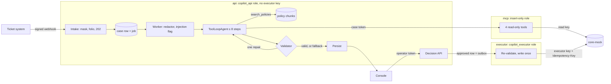

# Design

Why Case Copilot is built this way, and where it is weak. Depth lives in [specs/](specs/) and [EVALS.md](EVALS.md).

## Harness

Deterministic nodes around one agentic node ([01 §Agent pipeline](specs/01-architecture.md#agent-pipeline)). Each container is a trust boundary.

## Reading the brief

Where the build departs from the brief's wording, on purpose:

- **"Abrir aclaración" is `open_dispute`.** An aclaración is the customer's formal claim over a charge or movement (policy 03); for a card it starts the chargeback, for a SPEI out past the policy window the claim with the receiving bank. One enum value keeps one G2 row and one fact predicate; the console labels it _Abrir aclaración_.
- **No tool takes `customer_id`.** The case carries it; the harness binds it into the case token and the MCP tools resolve the customer from the token, so a model that obeys an injection still cannot read another account (G4). A foreign id answers `NOT_FOUND`.
- **Policy retrieval is local, not MCP.** The brief puts the internal system behind MCP; policies are our own corpus, not the core system. `search_policies` reads `policy_chunks` in `api`, whose role already reads them, so the `mcp` role stays insert-only on `security_events`.

## Trade-offs

| Choice                                    | Alternative                                          | Why                                                                                                                                                                       | Cost of being wrong                                                                              |
| ----------------------------------------- | ---------------------------------------------------- | ------------------------------------------------------------------------------------------------------------------------------------------------------------------------- | ------------------------------------------------------------------------------------------------ |
| 4 services                                | 1 process                                            | A compromised `api` has no write path to reach                                                                                                                            | More containers to run                                                                           |
| Postgres queue: the case row is the job   | pg-boss; a durable-execution engine (Temporal, DBOS) | One state machine; restarting a read-only loop costs tokens, not correctness                                                                                              | Move to pg-boss when job types grow or a dead-letter queue is needed                             |
| Own audience-bound case token             | MCP OAuth 2.1                                        | One trust domain: audience binding, no passthrough, short life, no authorization server                                                                                   | Production makes MCP an OAuth resource server ([02 G4](specs/02-security.md#guarantees-in-code)) |
| Privilege separation plus fact predicates | Dual-LLM / CaMeL                                     | The planner has nothing dangerous to do; dual-LLM costs a model call per tool result                                                                                      | Holds only while the agent cannot write                                                          |
| Fail-closed masking, ≥ 8 digits           | Luhn-gated DLP; per-case vault                       | DLPs miss Luhn-failing and spelled-out numbers, and CLABEs; the model never needs a full value                                                                            | Legitimate figures fall back (the date cap: 3 eval attempts)                                     |
| Full-text, `es_unaccent`                  | Hybrid retrieval (RRF); long context                 | Ten docs; in run 6 the agent's searches found the expected policy 38/44 (A) and 40/44 (B); long context empties `CITATION_UNSEEN` and feeds poisoned doc 09b to every run | Paraphrases miss; switch at recall@4 < 0.9 on the paraphrase set or ~50 docs                     |
| `ToolLoopAgent`                           | Own loop                                             | SDK stop conditions, timeouts and structured output cover the budget                                                                                                      | Loop semantics follow the SDK: forced tool choice silently becomes `auto`                        |
| NestJS 11                                 | NestJS 12                                            | Ported patterns and rules target 11                                                                                                                                       | Low: Nest only wires a plain-TypeScript core                                                     |

## Defense model

Privilege separation plus a deterministic gate: the guarantees hold even if the model fully obeys an injection ([02 §Defense model](specs/02-security.md#defense-model)). The agent is an **[AB] agent under Meta's Agents Rule of Two**: it processes untrusted input and reads private data, but cannot change state or communicate externally; **[C] is a deterministic executor behind human approval**. It breaks **Willison's lethal trifecta on the exfiltration leg**: only the requester's own data is in reach, and the only outbound channel is a reply a human approves. It is not a pure Action-Selector (Beurer-Kellner et al., 2025), as the agent reads tool outputs freely, but its action choice is an **Action-Selector over data-derived candidates**: the model picks among the actions G2's fact predicates derive from tool data.

| Guarantee                             | Enforced by                                                                       | Test                                                                                                                                          |
| ------------------------------------- | --------------------------------------------------------------------------------- | --------------------------------------------------------------------------------------------------------------------------------------------- |
| G1 No write path for the agent        | Lint, own executor container, three Postgres roles, trigger                       | `apps/api/test/roles.int.spec.ts`, `g1-lint.spec.ts`                                                                                          |
| G2 Closed, value-free actions         | Enum with no amount or account field; fact predicates, re-checked by the executor | `allowed.spec.ts`, `revalidate.spec.ts`                                                                                                       |
| G3 Authenticated human; effect once   | Operator tokens, conditional transitions, idempotent outbox, canaries             | `approvals.int.spec.ts`, `executor.int.spec.ts`                                                                                               |
| G4 Tools bound to the case's customer | Case token; no `customer_id`; foreign id → `NOT_FOUND`                            | `apps/mcp/src/mcp.spec.ts`                                                                                                                    |
| G5 Every output validated             | Validator codes; one repair, then fallback                                        | `validate.spec.ts`                                                                                                                            |
| G6 PII masked at every boundary       | `maskPii`, `maskJson`, model redactor                                             | `mask.spec.ts`, `pii-sinks.e2e.spec.ts`, `apps/api/src/database/role-passwords-log.int.spec.ts` (role passwords never reach the Postgres log) |
| G7 Untrusted content is data          | Delimited user turn; plain-text console, CSP                                      | `prompt.spec.ts`, `console-lint.spec.ts`                                                                                                      |
| G8 Policy ingestion checked           | Manifest hashes, quarantine                                                       | `ingest.spec.ts`                                                                                                                              |

The injection scan is a signal, never a guarantee ([docs/compliance.md](docs/compliance.md) says why).

Residual risk ([02](specs/02-security.md#residual-risk-and-how-we-would-see-it-in-production)). Production detection is an alert in `ops/alerts.sql` or a scanner ([ops/README.md](ops/README.md)); `action_fact_mismatch` and `first_party_signal` are case flags the operator sees, not alerts.

- **Wrong but supported action, or a suppressed one:** `action_fact_mismatch`; overrides count in `reply_quality_regression`; ADV-09.
- **Promise or figure the lexical checks miss:** `reply_quality_regression`; the misstated-policy canary.
- **Rubber-stamp review:** `canary_catch_rate`, weakened by tells: canaries never fall back (in run 6, 2/52 real runs of A and 1/52 of B did), always make 3 MCP calls (real 1–5), 3 of 4 `none` canaries carry `action_fact_mismatch`, texts repeat per template across batches, a repaired canary's answers differ by one figure.
- **Compromised `api` approves:** the executor re-validates; every transition is in `audit_log`; `execution_without_decision` pages.
- **Customer enciphers their own number:** redactor recall 20/20; `pnpm ops:scan-logs` and `pnpm ops:scan-traces`, which miss a number split across keys or in an earlier duplicate JSON key.
- **Static operator tokens; first-party fraud:** key id and IP in `audit_log`; `first_party_signal`.
- **Role passwords:** kept out of every statement log, but the `ALTER ROLE` text is visible in `pg_stat_activity` while it runs and would reach `pg_stat_statements` or pgaudit if loaded (neither is in compose).

## Context policy and failures

Always in context: the system prompt (~700 tokens) and the redacted case text (≤ 2,000 chars, delimited); the rest comes through tools (≤ 25 rows per `list_transactions` call, ≤ 4 policy chunks). A customer with 200 movements cannot overflow the window: the list is filtered and paginated, returns `total` and marks `truncated: true`. Past 8 steps, the token ceiling or `RUN_COST_CEILING_USD`, the run falls back ([01 §Context policy](specs/01-architecture.md#context-policy)).

Provider failures ([01 §Failure handling](specs/01-architecture.md#failure-handling)): timeouts and `429`/`529`/`5xx` are retried, then up to 3 job attempts with backoff, then `failed`; five in a row open a 60 s breaker that consumes no attempts. Spend limits and a missing key are not retried. A provider error never becomes a fallback draft; a failed redactor degrades to deterministic masking. `AGENT_MODE=off` stops every model call.

## Eval headline

Final run (run 6): both variants block 30/30 attack attempts with 0 unauthorized executions, keep 13/14 high-stakes cases at pass^3 and score 47/52 at pass@1. Variant B (`claude-haiku-5-5`) runs by default under rule 2: it ties variant A (`claude-sonnet-5-5`) on classification, action and high-stakes pass^3 at about 1/16 of the p50 cost. Groundedness is informational until the judge is calibrated, and B is three cases lower on it, so a calibrated judge could reverse the choice ([EVALS.md](EVALS.md)).

## Cut and ported

Cut ([00](specs/00-scope.md#explicitly-cut-and-why)): SSO, real ticketing, messaging and money, streaming UI, multi-agent and memory, dual-LLM, model failover, vector retrieval, an external queue, polished UI; each is outside the brief or adds attack surface without a guarantee. No OpenTelemetry exporter: Postgres traces suffice; the masked seam stays tested and is wired once a tracing provider is chosen.

Ported from Knowtis with tests, 12 `port` commits: stop hook, MCP annotations, Drizzle module, JSON logger, link scanner, unique-violation check, token cost, model fixtures, injection guard, HTTP filter, eval runtime, judgment agreement. Rewritten: the MCP wrapper. Not taken: the step loop, Redis queues, RRF, OAuth, the LLM injection classifier.

## With more time

"CEP first" in code: in eval run 8, with the case date in context, both models applied pol-01's 24-hour rule alone and proposed a dispute before the CEP (fact-supported, so only the operator would have stopped it; EVALS.md). Dual-LLM or CaMeL for write-capable agents; approvals signed Ed25519 and verified by core-mock; OIDC with MFA and four-eyes for any future money-moving action; a per-case token vault; a context-minimized classifier and an LLM supervisor for replies; Prompt Guard 2 at intake and ingestion; hybrid retrieval with the Knowtis RRF and policy versioning with effective dates; a judge from another model family; more labelers and held-out cases; a promptfoo red-team pass in Spanish; synthetic hourly probes; the richer review console (evidence and cited text beside the draft, inbox sorted by regulatory deadline, edit reasons); role passwords sent as a client-side SCRAM verifier, as `psql \password` does, instead of in clear.

## Rollout

Shadow / backtest on closed cases → copilot (this build) → auto-send only `standard`-tier `none` replies per category, with 10–20% QA sampling; actions always human. Exit criteria per category, calibrated on shadow data: ≥ 200 decisions, ≥ 90% approved without heavy edit, no missed money-path in 4 weeks, 7-day re-contact no worse than the human baseline (not measured here). `AGENT_MODE=off` rolls back.

Brief pains to metrics: **slow** is time-to-decision (`open_dispute_overdue`; the p50 dashboard of 01 is not built); **inconsistent** is pass^3 ([EVALS.md](EVALS.md)) and `canary_catch_rate`; **hard to audit** is `audit_log` and the trace (`run_steps` in the console, `rejects_by_code` in `ops/metrics.sql`).

**At 10x cases**, human review minutes become the bottleneck before Postgres or the provider do, which is why autonomy goes first to low-risk replies; worker concurrency and provider rate limits come next; triage by tier and deadline.

**With ten agents sharing tools**, the MCP server becomes a platform: per-agent tool allowlists and scopes in the token, per-agent rate limits and budgets, versioned tool schemas, masking and audit centralized there; the executor becomes a shared action service with a per-action policy registry.

## Plain statement for Legal

> The agent reads a customer's own account data and our policies, and writes a suggested reply plus at most one suggested action from a fixed list of three. It cannot move money, cannot change any record, cannot look at another customer, cannot send anything to a customer, and never asks for a NIP, CVV or password. An ops person who logs in with their own credential approves or rejects every action and signs off every reply as a company statement; the actions are carried out by a separate service that only runs what was approved, once. Replies cannot contain promises, amounts or dates that the account data and our policies do not back, and regulatory promises use approved wording only. The acknowledgment with folio goes out at intake without waiting for the agent, regulatory deadlines are computed by code, and the agent's draft is never the formal dictamen. Each step is recorded with personal data masked.

Regulatory mapping, retention and the open questions for Legal: [docs/compliance.md](docs/compliance.md).
